# Avito AI-Buddy: ИИ-наставник для стажёров 🚀
### Кейс хакатона Hack&Change 2026 • Avito Start

[](https://github.com/Lowstil/avito-ai-buddy/actions)
[](https://github.com/Lowstil/avito-ai-buddy/raw/master/docs/demo.mp4)
[-brightgreen.svg)](https://github.com/Lowstil/avito-ai-buddy)
[](https://www.python.org/)
[](https://react.dev/)
[](https://fastapi.tiangolo.com/)
[](https://ai.google.dev/)
[](https://modelcontextprotocol.io/)

> **Прототип Avito AI-Buddy** — глубоко интеллектуальный цифровой ко-пилот онбординга и инженерной адаптации в Авито с оптической архитектурой интерфейса **Liquid Glass (Glassmorphism)** и **Dual-Ergonomics (1920×1080 Full HD + Mobile 375px–768px)**. Система объединяет гибридный ИИ-движок (**Google Gemini 2.5 Flash + Playbook RAG + Deep Cognitive Synthesizer**), песочницу реального код-ревью (**AST/Compiler + AI Pre-flight Check**), протокол **MCP** и поддерживает **3 сквозные ролевые персоны (Multi-Persona Intelligence)**:
> 1. 🎓 **Стажёр (Арсений Новиков):** навигация по чек-листу, глубокие ответы по 16 инженерным гайдам Playbook (Zero Bug Policy, PaaS, Kafka, PostgreSQL Highload, Context Timeout, SRE), песочница Pre-flight Code Review, оформление отгулов без бюрократии, 5-уровневый карьерный роадмап и подготовка к 1:1.
> 2. 👨‍💻 **Наставник (Алексей Смирнов):** ИИ-аудит прогресса подопечного, синтез коучинговой повестки 1:1, генерация чек-листов код-ревью для джуна (Go, Postgres, таймауты, гонки, N+1), оценка готовности к Экватору (3 мес), согласование отгулов и RBAC-доступов в 1 клик.
> 3. 👩‍💼 **Тимлид (Екатерина Соколова):** инженерные DORA-метрики онбординга (Time to First PR = 2.4 дня), скоринг готовности к офферу в штат (Offer Readiness Score 82/100), аудит менторской нагрузки (4.5 ч/нед, 12% емкости) и безопасное распределение задач в Спринте 24.1 Delivery Core.

---

## 📑 Навигация по сдаче хакатона

1. 🎬 **Видеодемонстрация работы решения (MP4):** [**▶️ Смотреть / скачать видео (`docs/demo.mp4`)**](https://github.com/Lowstil/avito-ai-buddy/raw/master/docs/demo.mp4) • [**Открыть файл в GitHub (`docs/demo.mp4`)**](https://github.com/Lowstil/avito-ai-buddy/blob/master/docs/demo.mp4) — полное Full-HD видео пути пользователя от запроса до результата (интерфейс **Liquid Glass**, работа всех 3 ролей: Стажёр / Наставник / Тимлид, песочница Pre-flight Code Review с AST/Gemini анализом и эталоном Clean ZBP 100/100, Command Palette `Ctrl+K`, оформление отгула в чате и календаре, согласование наставником, сквозная синхронизация выдачи доступов и аналитические метрики тимлида).
2. 📸 **Скриншоты ключевых экранов:** каталог [`docs/screenshots/`](docs/screenshots/) с доказательствами работы интерфейса Liquid Glass и ответов гибридного ИИ.
3. 📊 **Продуктовая презентация (PDF и HTML):** [`docs/presentation/presentation.pdf`](docs/presentation/presentation.pdf) (исходник: [`docs/presentation/slides.html`](docs/presentation/slides.html)).
4. 📜 **SDD-спецификации (OpenSpec / spec-kit):** каталог [`specs/`](specs/).
5. 🧪 **Отчёт о покрытии тестами (87% при нормативе >80%, 112 тестов):** [`backend/htmlcov/`](backend/htmlcov/) (112 passed unit & integration tests).
6. 🔐 **Доступ для жюри:** для приватных репозиториев доступ предоставлен аккаунту `hack-and-change-2026`.

---

## 🎬 Видеодемонстрация (Demo Video)

> **Прямые ссылки на видеоролик (Full HD 1080p MP4):**
> * ▶️ [**Прямая ссылка на видео (`https://github.com/Lowstil/avito-ai-buddy/raw/master/docs/demo.mp4`)**](https://github.com/Lowstil/avito-ai-buddy/raw/master/docs/demo.mp4)
> * 📂 [**Страница видео в репозитории GitHub (`docs/demo.mp4`)**](https://github.com/Lowstil/avito-ai-buddy/blob/master/docs/demo.mp4)

<video src="https://github.com/Lowstil/avito-ai-buddy/raw/master/docs/demo.mp4" controls width="100%"></video>

[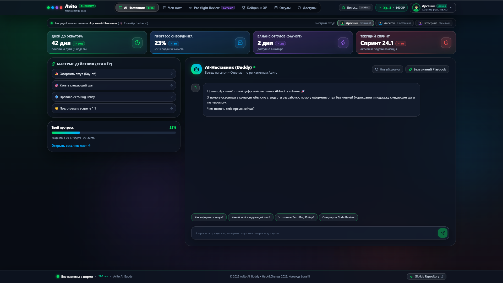](https://github.com/Lowstil/avito-ai-buddy/raw/master/docs/demo.mp4)

*Нажмите на превью или ссылку выше, чтобы сразу открыть и воспроизвести видео [`docs/demo.mp4`](https://github.com/Lowstil/avito-ai-buddy/raw/master/docs/demo.mp4).*

---

## 📸 Галерея интерфейса (Multi-Persona & Liquid Glass UI)

### 1. Персона Стажёра (Арсений Новиков)
| Дашборд стажёра и метрики онбординга (Liquid Glass) | Бронирование отгула через AI диалог |
|:---:|:---:|
|  | 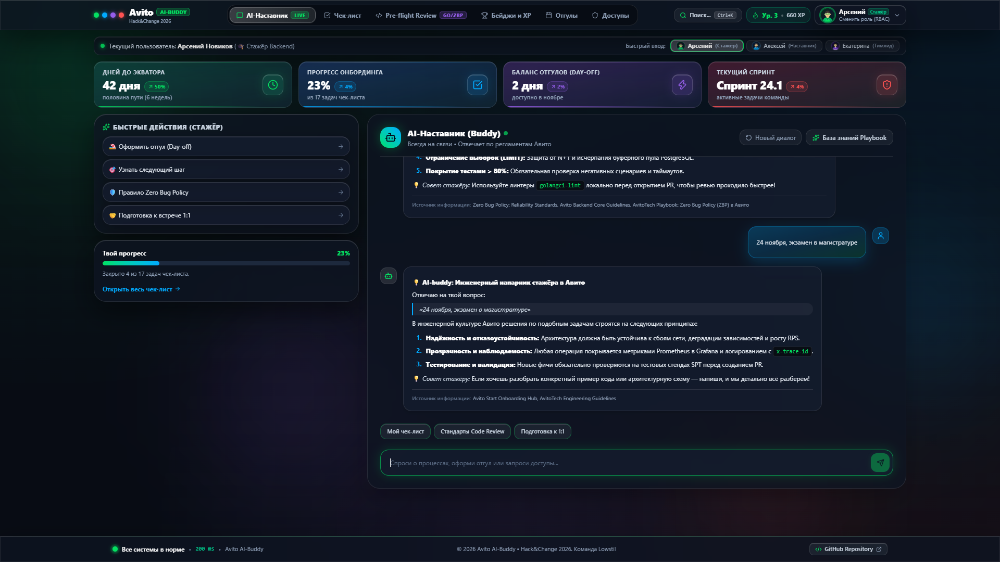 |

| Интерактивный календарь отгулов (Glassy Calendar) | Чек-лист с автосохранением заметок |
|:---:|:---:|
| 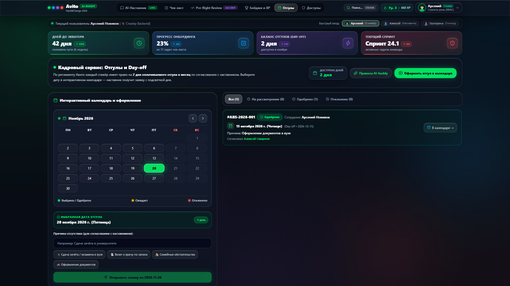 | 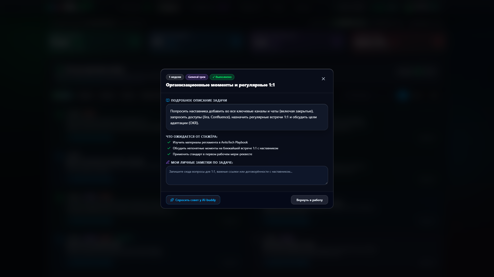 |

### 2. Персона Наставника / Buddy (Алексей Смирнов)
| Дашборд ментора: подопечный и нагрузка | AI-аудит прогресса подопечного стажёра |
|:---:|:---:|
| 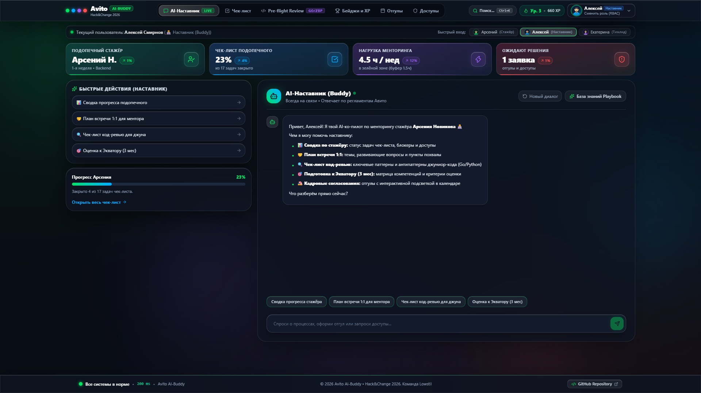 | 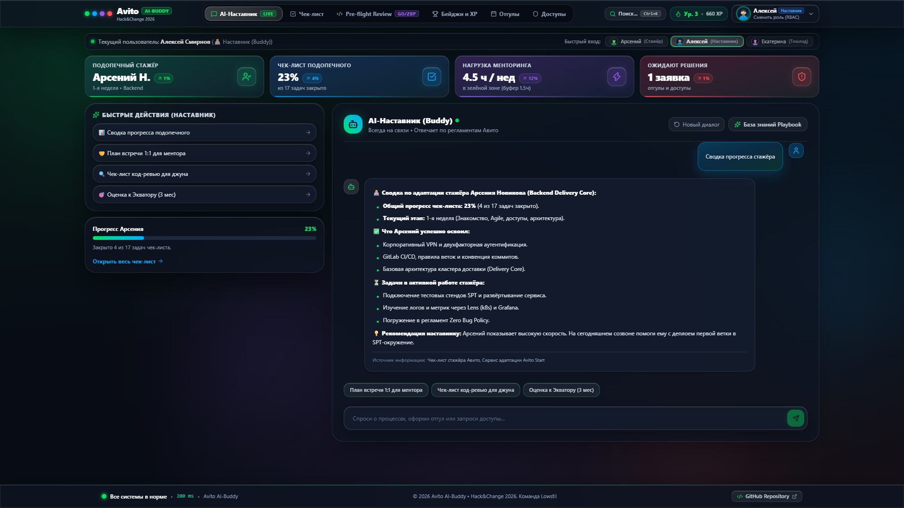 |

| Структурированный план встречи 1:1 для ментора | Чек-лист код-ревью джуниор-кода (Go/SQL) |
|:---:|:---:|
| 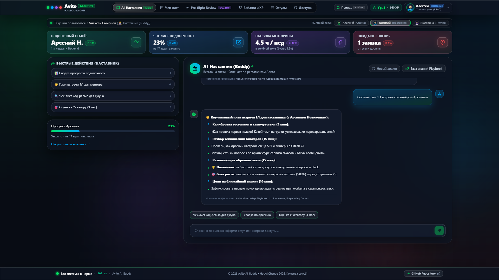 | 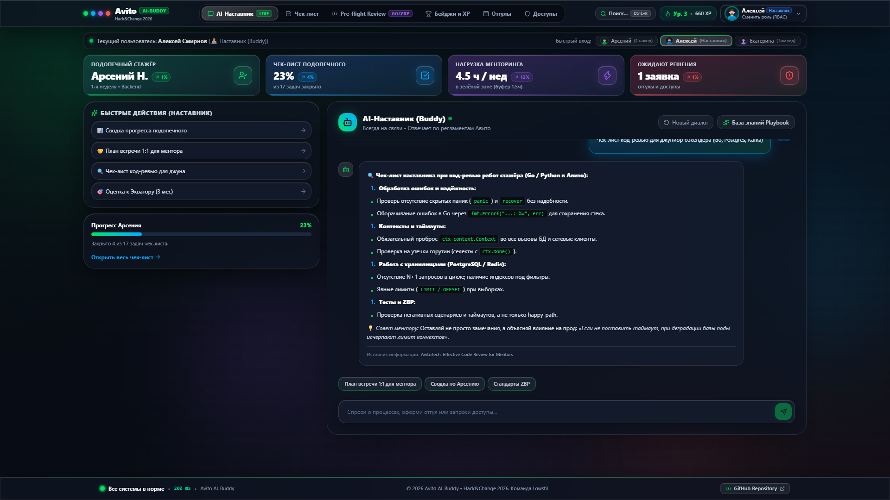 |

| Матрица оценки стажёра к Экватору (3 мес) | Синхронизированное подтверждение доступов |
|:---:|:---:|
| 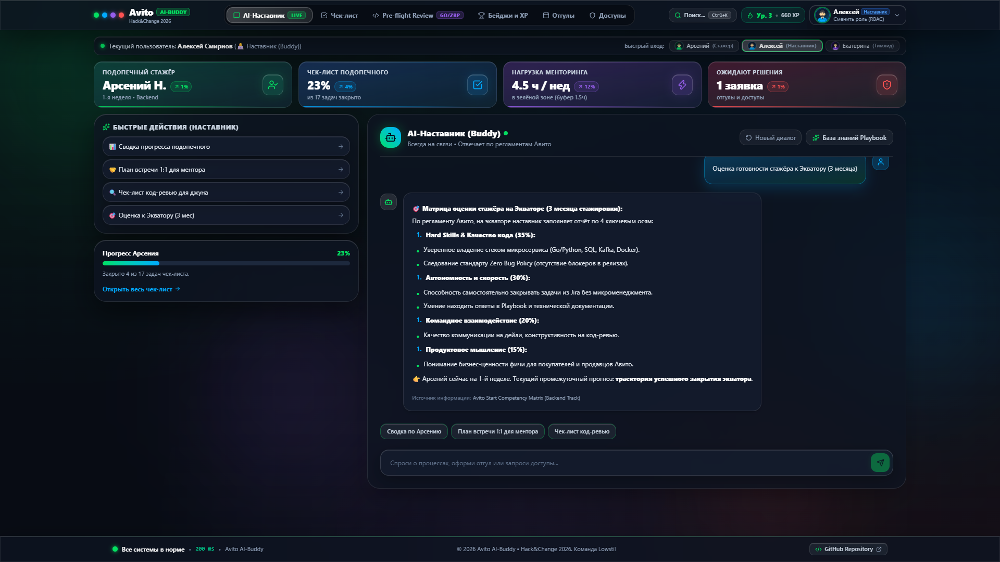 | 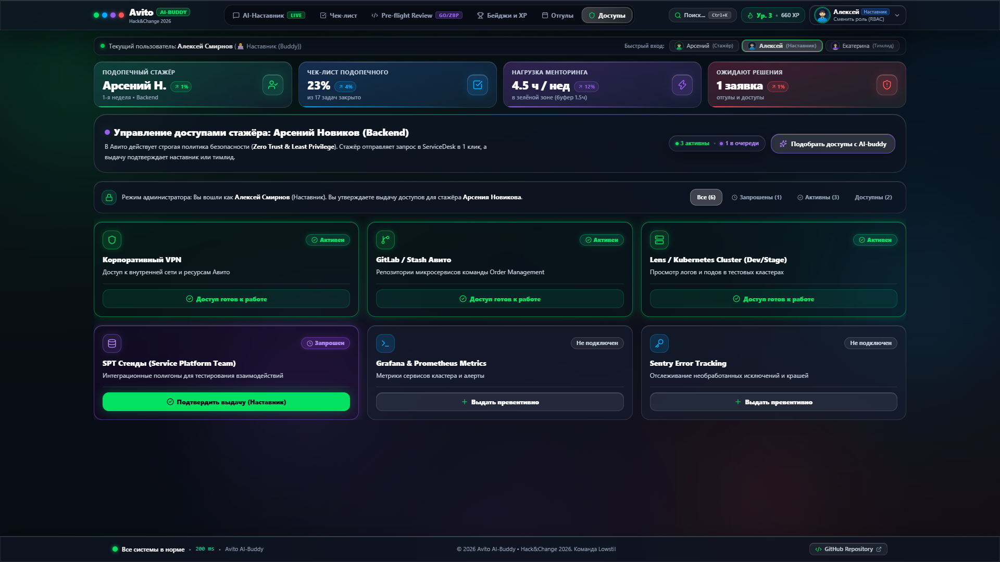 |

### 3. Персона Тимлида (Екатерина Соколова)
| Дашборд тимлида: Time to PR, Offer Score | DORA-метрики онбординга команды |
|:---:|:---:|
| 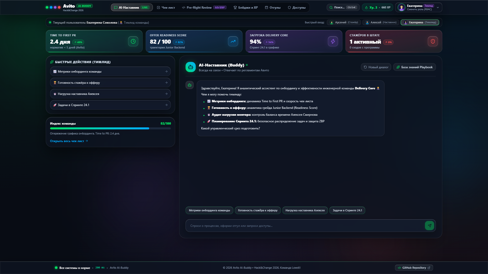 | 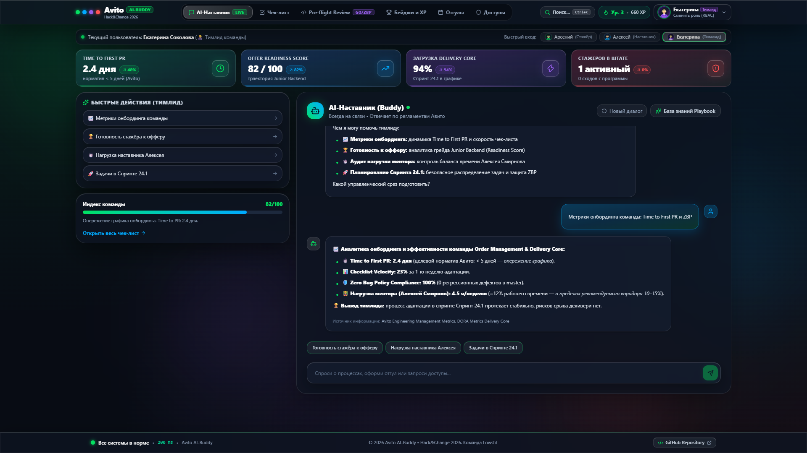 |

| Оценка готовности к офферу в штат (82/100) | Аудит нагрузки наставника Алексея (4.5 ч/нед) |
|:---:|:---:|
| 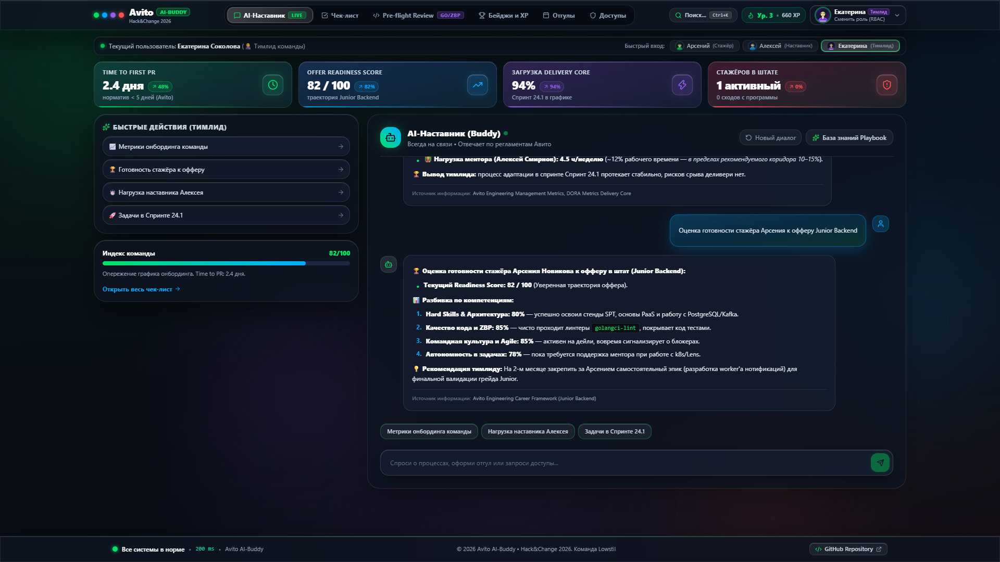 | 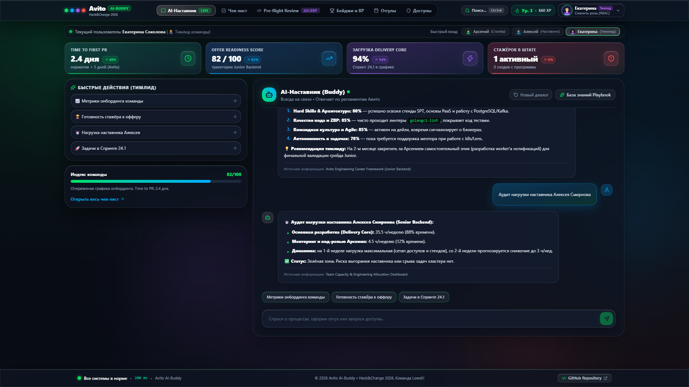 |

### 4. Инженерный полигон и геймификация (Hackathon Extensions)
| Pre-flight Code Review Sandbox (AST + Gemini 2.5) | Геймификация: 5 уровней карьеры и бейджи (Avito Start) |
|:---:|:---:|
| 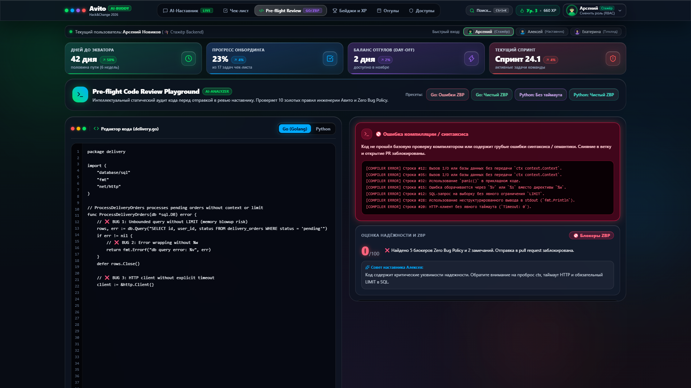 | 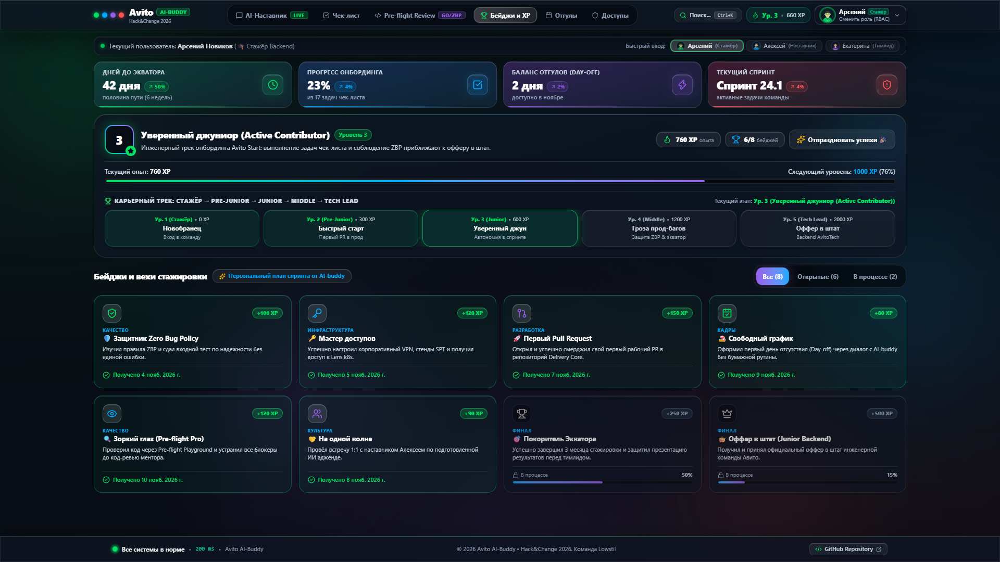 |

---

## 🌟 Ключевые возможности и функциональные модули

### 1. Интеллектуальный гибридный AI-чат (Gemini 2.5 Flash + Playbook RAG + Deep Cognitive Engine)
* **Трёхконтурная архитектура интеллекта:** объединяет облачную модель **Google Gemini 2.5 Flash**, семантический поиск **Playbook RAG по 16 глубоким инженерным гайдам Авито** (Zero Bug Policy, Context Timeout в Go, Kafka & Datanode, PostgreSQL Highload & Индексы, SRE & Incident Response, Observability: Grafana/Prometheus/Sentry, Архитектура микросервисов и PaaS Briefcase, Подготовка к Офферу и Экватору и др.) и автономный **Deep Cognitive Synthesizer (`fallback_service.py`)**.
* **Умная защита слот-филлинга (Smart Slot-Filling Guardrails):** если стажёр начал оформлять отгул, но внезапно переключился на технический или процессуальный вопрос (например, *«Что такое Zero Bug Policy?»* или *«Как пробросить context.Context?»*), ИИ мгновенно распознаёт смену интента, автоматически сбрасывает незавершённый слот-филлинг отгула и даёт развёрнутый инженерный ответ вместо ошибки парсинга даты.
* **Ролевая персонализация (Multi-Persona Intelligence):**
  * **Стажёр:** глубокие объяснения архитектуры, стандартов код-ревью и ZBP с примерами кода, пошаговый онбординг по чек-листу, диалоговое бронирование отгулов, генерация самоотчёта к 1:1.
  * **Наставник:** ИИ-аудит прогресса стажёра, генерация коучинговой повестки 1:1, чек-листы ревью джуниор-кода, матрица оценки к Экватору (3 мес).
  * **Тимлид:** аналитика DORA Time to First PR (2.4 дня), Offer Readiness Score (82/100), аудит ёмкости наставника (88% прод-разработка / 12% менторинг), рекомендации по бэклогу Спринта 24.1.

### 2. Реальная AI-песочница код-ревью (Pre-flight Code Review Sandbox)
* **Многоуровневая AST и синтаксическая валидация компилятором:** перед проверкой бизнес-логики код проходит через Python `ast.parse()`, лексер `Pygments` и структурно-синтаксический анализатор Go/SQL. Некомпилируемый код, незакрытые скобки, опечатки ключевых слов или мусорный ввод немедленно получают вердикт `syntax_error` с точным указанием строки.
* **Глубокий аудит безопасности и Highload-паттернов (Gemini 2.5 Flash + Static Analyzer):**
  * Детекция **SQL-инъекций** (конкатенация строк в SQL-запросах вместо параметризованных плейсхолдеров `$1, $2`).
  * Выявление **Race Conditions** (конкурентная запись в `map` или разделяемую память без `sync.Mutex` / каналов в горутинах).
  * Контроль **10 золотых правил инженерии Авито и ZBP:** потеря `context.WithTimeout` при вызовах БД/HTTP, вызов `panic()` в продакшене, игнорирование ошибок `_ = err` и отсутствие обёртки `fmt.Errorf("%w", err)`, проблема **N+1 запросов в цикле**, `SELECT *` без `LIMIT`, утечки транзакций без `defer tx.Rollback()`, хардкод секретов и токенов.
* **Интерактивный IDE-интерфейс:** нумерация строк, готовые пресеты кода (код с уязвимостями/багами и эталонный код «Эталон (Clean ZBP)» с оценкой 100/100), вкладка со всеми замечаниями и диффами, а также вкладка **«Исправленный код от AI»** с готовым к PR рефакторингом в 1 клик.

### 3. Command Palette (`Ctrl+K` / `Cmd+K`) и Toast Hub
* **Глобальная палитра команд (`Ctrl+K`):** мгновенный вызов из любой точки интерфейса для переключения между 6 вкладками, смены ролевой персоны (Стажёр / Наставник / Тимлид), запуска быстрых ИИ-промптов и перехода к задачам чек-листа с полной клавиатурной навигацией (`↑`/`↓`/`Enter`/`Esc`).
* **Живой центр уведомлений (Toast Hub):** всплывающие Liquid Glass уведомления в реальном времени при получении XP, открытии бейджей, согласовании отгулов, выдаче RBAC-доступов и автосохранении заметок.

### 4. Система геймификации и 5-уровневый карьерный роадмап (Avito Start)
* **Динамический опыт (XP) и 5 ступеней инженерного роста:** *Ур. 1: Стажёр-исследователь → Ур. 2: Инженер стажёр (Avito Start) → Ур. 3: Уверенный контрибьютор → Ур. 4: Мастер надёжности (ZBP) → Ур. 5: Готов к штату (Junior Backend Engineer)*.
* **Интерактивный Career Roadmap и витрина из 8 бейджей:** наглядный трекинг прогресса по каждому бейджу, мгновенное начисление XP за закрытие задач чек-листа и прохождение Pre-flight Code Review, праздничное конфетти.

### 5. Оформление кадрового действия (Заказ отгула / Day-off)
* **Естественная обработка дат и диалоговый слот-филлинг:** распознавание любых пользовательских дат (русские названия месяцев, `DD.MM`, «завтра», «25 декабря»), проверка баланса (2 дня в месяц), вызов MCP-инструмента `request_absence` и выпуск карточки заявки `#ABS-2026-X`.
* **Интерактивный календарь `GlassyCalendar`:** визуальный выбор дня в сетке месяца, подсветка статусов заявок и обязательный **мотивированный отказ** при отклонении наставником (выбор быстрых чипов причин).

### 6. Сквозная синхронизация и матрица RBAC-доступов
* Управление доступами к 6 ключевым инфраструктурным системам Авито (**GitHub Enterprise, Staging K8s / Lens, PaaS Briefcase / SPT, Grafana & Prometheus, Sentry Error Tracking, Datanode / ClickHouse**).
* Стажёр запрашивает доступ в 1 клик (`request_access`), а наставник подтверждает выдачу (`grant_access`) с мгновенной синхронизацией статуса до «Активен».

### 7. Интерактивный чек-лист адаптации с автосохранением заметок
* Официальная структура Backend-трека Авито: *1 неделя, 2 неделя (PaaS), 1 месяц (Защита ПДн и КИ), Экватор 3 мес, Выпускной*.
* Персональные заметки стажёра к каждой задаче с индикатором автосохранения на бэкенде и кнопкой мгновенной ИИ-консультации по конкретному пункту.

### 8. Защита данных (Security Guardrails)
* Запросы конфиденциальной информации (зарплаты коллег, пароли прод-БД, админ-токены) перехватываются контуром безопасности со ссылкой на Политику защиты коммерческой тайны (КИ) Авито.

---

## 🎨 Оптическая архитектура интерфейса: Liquid Glass & Dual-Ergonomics

Интерфейс полностью спроектирован по канонам **Liquid Glass (Glassmorphism)** в тёмной палитре космоса (`#060911`) с фирменными неоновыми акцентами Авито (зелёный `#04E061`, синий `#00AAFF`, фиолетовый `#965EEB`, коралловый `#FF5252`):

* **6-уровневая оптическая система высот (Optical Elevation Hierarchy):**
  * Токенизированные слои стекла (`glass-panel`, `glass-elev-1`..`5`, `glass-card-interactive`, `glass-modal`, `glass-dock`, `glass-pill`, `glass-input`) с многослойным размытием `backdrop-filter: blur(16px–32px) saturate(180%)`.
  * **Specular Highlights:** тонкие зеркальные блики верхней грани (`inset 0 1px 0 rgba(255,255,255,0.18)`), динамические градиентные рамки и фоновые плазменные сферы (`ambient glow spheres`).
* **Эргономика Desktop Full HD (1920×1080):**
  * Расширенный рабочий контейнер `2xl:max-w-[1536px]` без пустых боковых полей.
  * Компактный одноуровневый хедер (`60px`), плотная посадка карточек метрик (`<= 88px`) и отсутствие ловушек двойного скролла (`zero double-scroll traps`) — вся ключевая информация помещается на одном экране 1080p.
* **Нативная мобильная эргономика (Mobile 375px–768px):**
  * Нижняя док-панель навигации в стиле iOS (`MobileNavBar` / `glass-dock`, `fixed bottom-0 h-16`) для удобного переключения вкладок большим пальцем.
  * Гарантированные области нажатия **`>= 44px` (WCAG Touch Targets)** для всех интерактивных элементов, адаптивные модальные окна (`max-h-[88dvh]` с внутренним скроллом) и отсутствие горизонтального переполнения на экранах от `375px`.

---

## 🏗️ Архитектура решения

```
┌────────────────────────────────────────────────────────────────────────────┐
│                Frontend UI: React 19 + TypeScript + Tailwind v4            │
│    Liquid Glass 6-Tier Elevation • 1920x1080 & 375px Mobile Ergonomics     │
│        Command Palette (Ctrl+K) • Toast Hub • Multi-Persona State          │
└─────────────────────────────────────┬──────────────────────────────────────┘
                                      │ REST / JSON (Latency < 200ms)
                                      ▼
┌────────────────────────────────────────────────────────────────────────────┐
│                 Backend Core: FastAPI (Clean Architecture)                 │
│       Multi-Persona Agent • RBAC Middleware • AST & Pygments Validator     │
└───────────┬─────────────────────────┬──────────────────────────┬───────────┘
            │                         │                          │
            ▼                         ▼                          ▼
┌───────────────────────┐ ┌────────────────────────┐ ┌───────────────────────┐
│   Hybrid AI Engine    │ │  MCP Tool Server (AI)  │ │  Корпоративные моки   │
│ - Gemini 2.5 Flash    │ │ - request_absence      │ │ - Absence System      │
│ - Playbook RAG (16)   │ │ - request_access/grant │ │ - IAM / ServiceDesk   │
│ - Deep Cognitive      │ │ - get_checklist_status │ │ - Gamification & XP   │
│   Synthesizer         │ │ - search_playbook      │ │ - Clickstream / Prom  │
└───────────────────────┘ └────────────────────────┘ └───────────────────────┘
```

---

## 🚀 Инструкция по запуску

### Способ 1: Локальный запуск в одну команду (Рекомендуемый)

Требования: Python 3.11+ и Node.js 18+.

```bash
# 1. Склонировать репозиторий
git clone https://github.com/Lowstil/avito-ai-buddy.git
cd avito-ai-buddy

# 2. Установить зависимости бэкенда
pip install -r backend/requirements.txt

# 3. Установить зависимости фронтенда и собрать проект
cd frontend
npm install --legacy-peer-deps
npm run build
cd ..

# 4. Запустить единым скриптом
python run.py
```
Скрипт `run.py` автоматически запустит FastAPI (порт `8000`), Vite (порт `4173`) и откроет браузер по адресу `http://localhost:4173`!

---

### Способ 2: Запуск через Docker Compose

```bash
docker compose up --build
```
Приложение будет доступно по адресу `http://localhost:8000`.

---

## 👥 Тестовые учётные записи (Синтетические данные)

Для удобной проверки экспертами в правом верхнем углу интерфейса (или через `Ctrl+K`) доступен **мгновенный переключатель ролевых персон (RBAC)**:

| Пользователь | Роль | Описание и доступные действия |
| :--- | :--- | :--- |
| **Арсений Новиков** (`intern_1`) | `intern` (Стажёр Backend) | Чат с ИИ-наставником, Pre-flight Code Review, создание заявок на отгул, чек-лист с заметками, запрос доступов, 5 уровней карьеры и бейджи. Самосогласование отгулов запрещено (`403`). |
| **Алексей Смирнов** (`mentor_1`) | `mentor` (Наставник / Buddy) | Ко-пилот менторинга, аудит прогресса стажёра, повестка 1:1, генерация чек-листов ревью, оценка к Экватору, утверждение/отклонение отгулов и доступов. |
| **Екатерина Соколова** (`lead_1`) | `lead` (Тимлид) | ИИ-ассистент инженерного менеджмента, метрики Time to First PR (2.4 дн.), Offer Readiness Score (82/100), аудит нагрузки ментора и планирование спринта. |

---

## 🧪 Запуск тестов и отчёт о покрытии (>80%)

Покрытие строк прикладного кода тестами составляет **87%** (при требовании регламента >80%). Всего реализовано и успешно проходит **112 автоматических тестов** (включая тесты Gemini 2.5 Flash, Deep Cognitive Fallback, AST/синтаксического анализатора кода, RBAC, слот-филлинга отгулов и MCP-инструментов).

```bash
# Запуск единого скрипта полной верификации (SDD, 112 тестов, покрытие, сборка фронтенда)
python verify_all.py

# Или запуск pytest напрямую с формированием HTML-отчёта:
cd backend
pytest --cov=app --cov-report=term-missing --cov-report=html:htmlcov
```

### Сводка покрытия (pytest-cov):
```text
Name                                    Stmts   Miss  Cover
-----------------------------------------------------------
app/api/analytics.py                       14      0   100%
app/api/auth.py                            10      0   100%
app/api/chat.py                             8      0   100%
app/api/code_review.py                      8      0   100%
app/api/gamification.py                     8      0   100%
app/api/glossary.py                        12      0   100%
app/api/health.py                          10      0   100%
app/core/config.py                         12      0   100%
app/core/rbac.py                           14      0   100%
app/models/schemas.py                      85      0   100%
app/services/gamification_service.py       37      0   100%
app/services/glossary_service.py           15      0   100%
app/services/playbook_rag.py               41      0   100%
app/api/checklist.py                       31      1    97%
app/api/access.py                          24      1    96%
app/main.py                                31      2    94%
app/mcp/tools.py                           74      7    91%
app/services/absence_service.py            65      7    89%
app/services/checklist_service.py          55      6    89%
app/api/absence.py                         34      4    88%
app/services/agent_service.py             203     29    86%
app/services/fallback_service.py          212     34    84%
app/services/access_service.py             33      6    82%
app/services/code_review_service.py       310     59    81%
-----------------------------------------------------------
TOTAL                                    1457    186    87%  ✅
======================= 112 passed in 1.40s =======================
```
Интерактивный HTML-отчёт сохранён в папке `backend/htmlcov/index.html`.

---

## 🔑 Внешние API и гибридный режим работы (Gemini 2.5 Flash + Deep Cognitive Fallback)

Система спроектирована для **безотказной работы из коробки**:
1. **Автономный Deep Cognitive + RAG режим (работает мгновенно без ключей):** экспертам и жюри **НЕ обязательно** настраивать платные API-ключи. При отсутствии внешнего ключа или лимитах сети система автоматически использует встроенный движок `Deep Cognitive Synthesizer`, базу из 16 инженерных гайдов `Playbook RAG`, AST-компилятор и реальные вызовы MCP-инструментов.
2. **Облачный режим Google Gemini 2.5 Flash / OpenAI (подхватывается автоматически при наличии ключа):**
   При передаче переменной окружения `GEMINI_API_KEY` (в `.env` или окружении) активируется прямая генерация и ревью кода через `gemini-2.5-flash`:
   ```bash
   export GEMINI_API_KEY="AIzaSy..."
   ```

---

## 📈 Метрики ценности и способ замера эффекта (A/B пилот)

* **North Star Metric:** Время рутины ментора на 1 стажёра — **снижение с 40–48 ч до 22–24 ч (-45%)**.
* **Time to First PR:** ускорение выхода на первый PR **с 5.0 дней до 2.4 дней (-52%)** за счёт мгновенного Pre-flight Code Review и выдачи доступов.
* **AI Resolution Rate:** более **82%** типовых вопросов по архитектуре, процессам и заявкам решаются ассистентом без отвлечения сеньор-инженеров.
* **A/B Эксперимент:** Пилотный запуск на 40 стажёрах тестовой группы против 40 контрольной группы с трекингом событий в Clickstream и анализом календарей наставников.

---

## 👨‍💻 Автор решения
* **Команда:** Lowstil
* **GitHub:** [@Lowstil](https://github.com/Lowstil)
* **Email:** lowstil192@gmail.com
